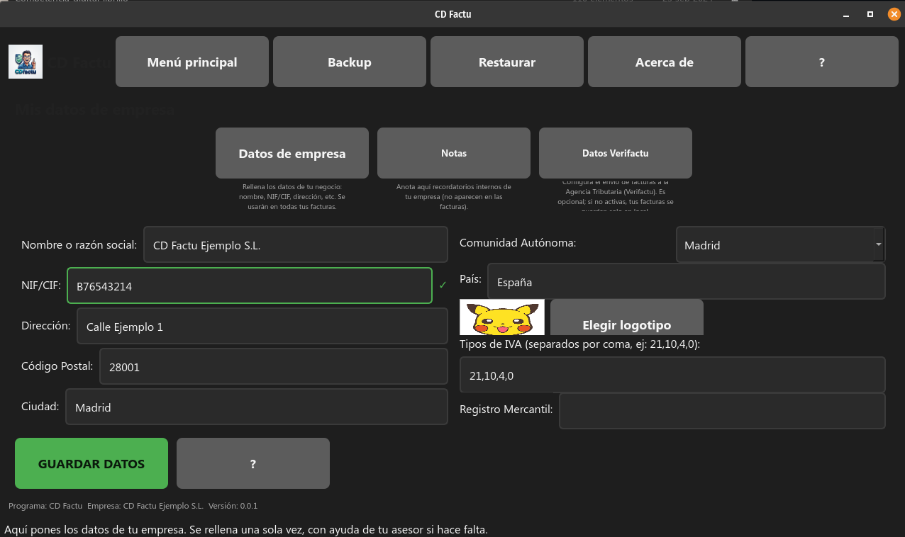
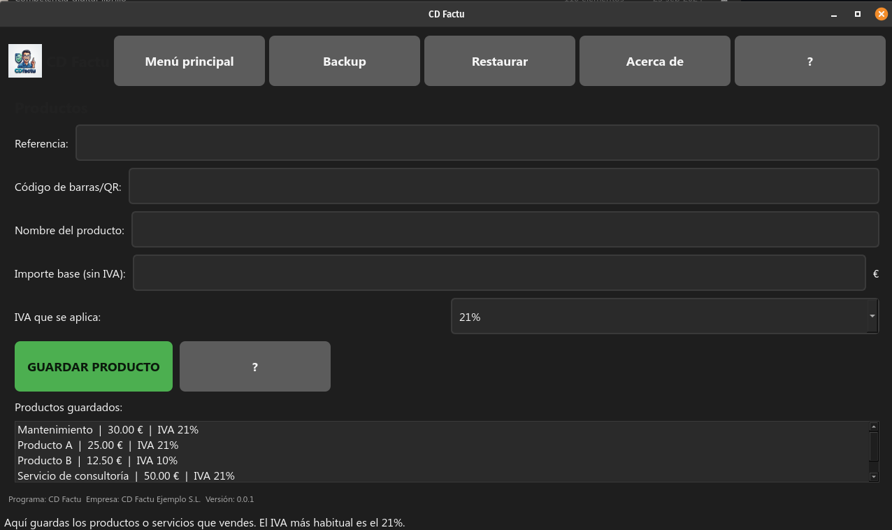
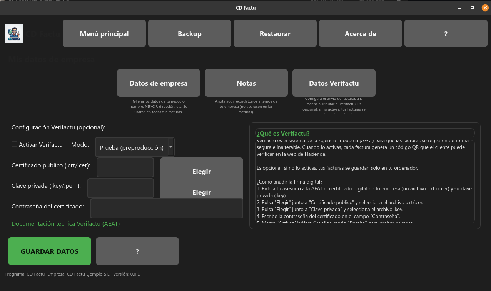
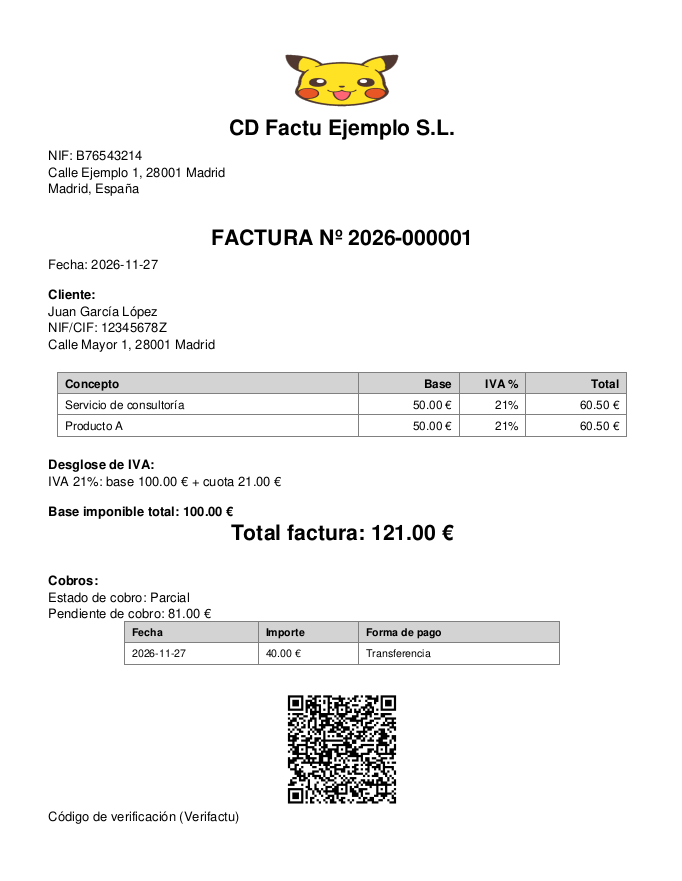

# CD Factu (Windows)

Programa de facturación sencilla para autónomos y micropymes, con integración de **Verifactu**.
Esta es la versión para **Windows**.

## Requisitos del sistema (Windows)
- Windows 10 o superior.
- No requiere instalación de Python (ejecutable incluido en la Release).
- El programa se ejecuta directamente; la base de datos se crea automáticamente.

## Características principales
- Interfaz sencilla, botones grandes y tema oscuro.
- Gestión de empresa, clientes, productos y facturas.
- Emisión de facturas en PDF con código QR Verifactu.
- Control de cobros y estado de pago.
- Anulación/rectificación de facturas (sin borrar).
- Copia de seguridad y restauración de datos.
- Funciona sin conexión a internet (datos locales).

## Capturas de pantalla

### Menú principal


### Mis datos de empresa


### Clientes


### Productos


### Emitir factura


### Facturas emitidas


### Certificado Verifactu


### Factura generada (PDF)


## Instalación

### Opción 1: Ejecutable (recomendado, sin instalación)
1. Descarga `CD-Factu.exe` desde la sección **Releases**.
2. Ejecútalo con doble clic. Se crea la base de datos automáticamente en `%APPDATA%\CD Factu\`.

### Opción 2: Desde código fuente
Requisitos: Python 3.10+ y las dependencias de `requirements.txt` (PySide6, reportlab, qrcode, Pillow).

```bat
git clone https://github.com/davidcasascompetenciadigital-prog/CD-Factu.git
cd CD-Factu
pip install -r requirements.txt
python main.py
```

### Opción 3: Compilar ejecutable
```bat
pip install pyinstaller
build-windows.bat
```
El ejecutable se genera en `dist\CD-Factu.exe`.

## Uso
1. Ejecuta el programa (se crea la base de datos automáticamente en `%APPDATA%\CD Factu\`).
2. Rellena "Mis datos de empresa" (con ayuda de tu asesor si es necesario).
3. Añade clientes y productos.
4. Emite facturas desde "Emitir factura".
5. Consulta e imprime en "Facturas emitidas".

Los datos se guardan en `%APPDATA%\CD Factu\` y las copias de seguridad en `%USERPROFILE%\Desktop\Backup_Facturas`.

## Verifactu
Modalidad local: no requiere certificado por parte del usuario final. Configuración opcional de certificado (prueba/real) en "Mis datos de empresa".

## Licencia
Creative Commons Compartir Igual Mención (CC BY-SA). Software GRATUITO.

## Autor
David Casas M.
- YouTube: @Competencia_Digital
- Twitch: davidcasasm
- GitHub: davidcasascompetenciadigital-prog
