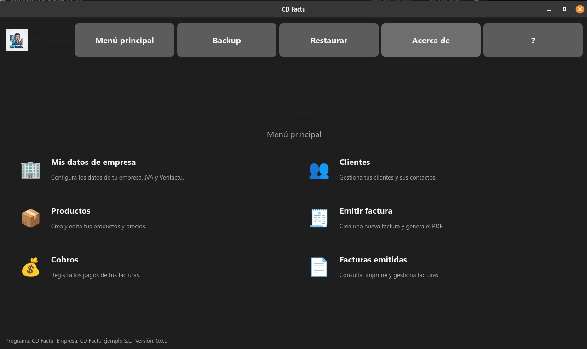
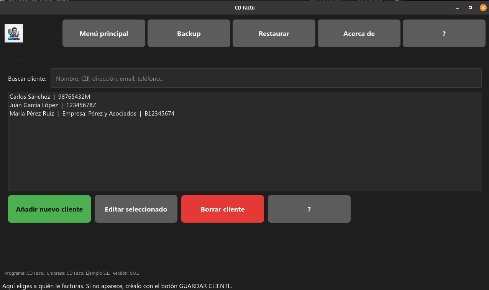
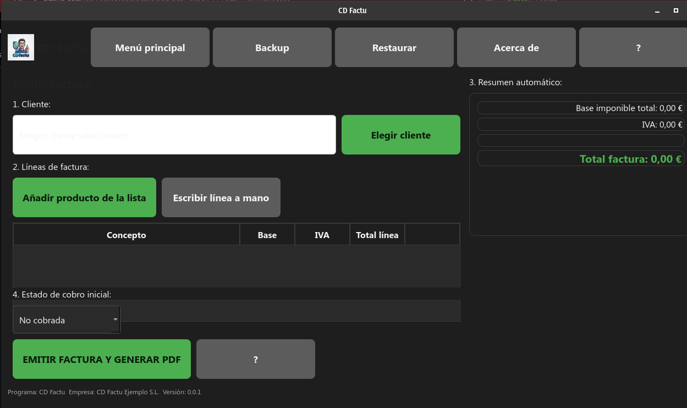
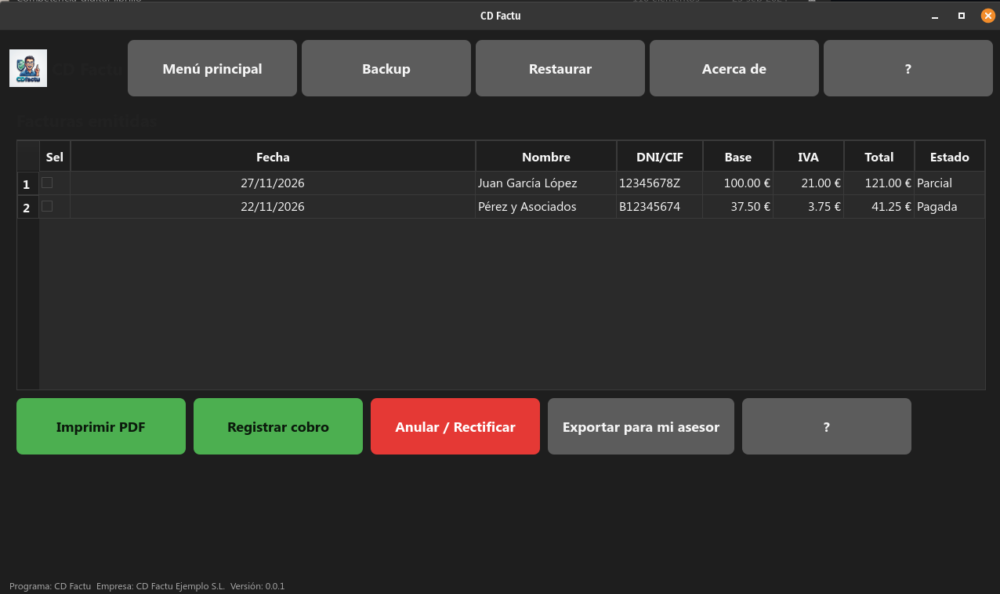

# CD Factu

**CD Factu** es un programa de facturación sencilla para autónomos y micropymes, con integración de **Verifactu** (modalidad local: registros inalterables encadenados por hash, código QR de validación AEAT y exportación para el asesor).

Esta es la versión para **Windows** (también hay workflow de compilación para Linux/AppImage).

## Requisitos del sistema (Windows)
- Windows 10 o superior.
- No requiere instalación de Python (ejecutable incluido en la Release).
- El programa se ejecuta directamente; la base de datos se crea automáticamente en `%APPDATA%\CD Factu\`.

## Características principales
- Interfaz ultra-sencilla, con botones grandes y tema oscuro.
- Gestión de empresa (con notas internas y submenú de Verifactu), clientes, productos y **servicios**.
- Emisión de facturas en PDF con QR Verifactu, cantidad, precio y descuento por línea.
- Control de cobros y estado de pago.
- **Retención de IRPF** en facturas emitidas y en facturas recibidas.
- **Gastos** (facturas recibidas) y balance trimestral (modelo 303).
- **Balance anual (modelo 390 + previsión de IRPF)**.
- Anulación/rectificación de facturas (sin borrar).
- Copia de seguridad automática al cerrar, con botones **Backup** y **Restaurar**.
- Verificación de versiones con auto-descarga desde GitHub Releases.
- Funciona sin conexión a internet (datos locales).

## Capturas de pantalla

### Menú principal


### Mis datos de empresa


### Clientes


### Productos


### Emitir factura


### Facturas emitidas


### Certificado Verifactu


### Factura generada (PDF)


## Instalación

### Opción 1: Ejecutable (recomendado, sin instalación)
1. Descarga el `.exe` desde la sección **Releases**.
2. Ejecútalo con doble clic. Se crea la base de datos automáticamente en `%APPDATA%\CD Factu\`.

### Opción 2: Desde código fuente
Requisitos: Python 3.10+ y las dependencias de `requirements.txt` (PySide6, reportlab, qrcode, Pillow).

```bat
git clone https://github.com/csjdeacon/CD-Factu.git
cd CD-Factu
pip install -r requirements.txt
python main.py
```

> Nota: para compilar el ejecutable de Windows se usa `cryptography==44.0.3`.

### Opción 3: Compilar ejecutable
```bat
pip install pyinstaller
build-windows.bat
```
El ejecutable se genera en `dist\CD-Factu.exe`.

## Uso
1. Ejecuta el programa (se crea la base de datos automáticamente en `%APPDATA%\CD Factu\`).
2. Rellena "Mis datos de empresa" (con ayuda de tu asesor si es necesario). Hay tres páginas: datos, notas internas y Verifactu.
3. Añade clientes, productos y servicios.
4. Emite facturas desde "Emitir factura" (búsqueda inline de clientes o "Listado de clientes").
5. Consulta, imprime y gestiona facturas desde "Facturas emitidas".
6. Apunta las facturas recibidas en "Gastos" y consulta los resultados en "Balance trimestral" y "Balance anual".
7. Usa **Backup**/**Restaurar** en la cabecera para gestionar copias de seguridad.

En la primera ejecución se ofrece cargar datos de ejemplo para probar el flujo.

Los datos se guardan en `%APPDATA%\CD Factu\` y las copias de seguridad en `%USERPROFILE%\Desktop\Backup_Facturas`.

## Verifactu
- Modalidad local: no requiere certificado por parte del usuario final.
- Configuración opcional de certificado (prueba/real) en “Mis datos de empresa” → “Datos Verifactu”.
- Admite certificado `.p12/.pfx` (con contraseña) o público `.crt/.cer/.pem` con clave privada `.key/.pem`.
- QR generado según normativa (versión 1, borde 4, corrección M).
- Exportación de registros para el asesor (“Exportar para mi asesor”).

## Garantía y licencia
Este software se proporciona **“tal cual” (AS IS)**, **SIN GARANTÍA** de ningún tipo, ni expresa ni implícita. El usuario asume toda la responsabilidad de su uso.

Licencia: **Creative Commons Compartir Igual Mención (CC BY-SA)**. Software GRATUITO.

## Autor
David Casas M.
- YouTube: @Competencia_Digital
- Twitch: davidcasasm
- GitHub: davidcasascompetenciadigital-prog

Integración y mantenimiento de esta rama: csjdeacon (fork).

## Versión
0.0.7 (integración de las mejoras del autor v0.0.5/v0.0.6 con servicios, gastos, balances y retenciones del fork)

---

## Novedades de la versión 0.0.7

- **Integración total con el autor:** se conservan simultáneamente las mejoras publicadas por David en sus versiones 0.0.5 y 0.0.6 y las de esta rama (servicios, gastos, balance trimestral/anual, Verifactu y retenciones IRPF).
- **Del autor (v0.0.5):** QR Verifactu según normativa (versión 1 y borde 4), backup automático al cerrar, verificación de versiones con auto-descarga, botones **Backup** y **Restaurar**, ajustes de interfaz y nuevo submenú en “Mis datos de empresa” con páginas de **Notas** y **Datos Verifactu**.
- **Del autor (v0.0.6):** la tabla de líneas y el PDF muestran **Cantidad**, **Precio** y **Dto.%**, con la sección **Total descuento**; el visor de facturas muestra emisor y cliente en columnas.
- **De esta rama:** se mantiene el botón **Añadir servicio**, los campos de retención IRPF al emitir y al registrar gastos, el balance anual (modelo 390 y previsión de IRPF) y el botón **Verifactu / AEAT**.
- Los conceptos de servicio con descripción larga siguen respetando el salto de línea en el PDF y en la previsualización.

---

## Novedades de la versión 0.0.6

- **Balance anual:** nueva pantalla con el resumen del año para el **modelo 390** (IVA devengado y deducible por tipo, resultado del régimen general, volumen de operaciones y desglose por trimestres). Genera hoja de trabajo en **PDF/CSV**.
- **Previsión de IRPF:** calcula el rendimiento neto estimado (facturación sin IVA − gastos − IVA no deducible), aplica un **tipo efectivo configurable** (20 % por defecto) y resta las retenciones sufridas. Muestra aparte las retenciones practicadas a proveedores, que se declaran en el modelo 111 y no reducen tu cuota.
- **Retenciones:** al emitir facturas se puede aplicar el porcentaje de retención (0/7/15/19/20/21 %); el PDF muestra la retención y el importe a cobrar. Al registrar gastos ocurre lo mismo (0/1/2/7/15/19/20/21 %), con su columna en la tabla.
- **Aviso:** la previsión de IRPF es orientativa y no sustituye la escala de tu Comunidad Autónoma ni el asesoramiento profesional.

---

## Novedades de la versión 0.0.5

- **Del autor (v0.0.3):** *Facturas emitidas* añade columna **Núm.FRA.**, botón **Ver factura** con visor y botón **Imprimir**; ajuste de columnas y doble clic para ver la factura.
- **Del autor (v0.0.4):** *Productos* pasa a dos columnas con búsqueda por nombre o referencia; *Emitir factura* incorpora búsqueda inline de clientes (nombre, CIF, email y teléfono); el visor de factura muestra emisor y cliente en dos columnas.
- **De esta rama (0.0.2):** servicios con descripción por factura, gastos y balance trimestral con hoja del modelo 303, y Verifactu con QR oficial, envío SOAP y vista previa. Todo ello convive con las mejoras anteriores.

> El visor del autor imprime ahora el PDF respetando la leyenda del QR oficial de Verifactu cuando la factura está registrada.

---

## Novedades de la versión 0.0.2

- **Logo:** la pantalla de carga es más grande y ya no se queda por encima de la ventana ni de los avisos; la pregunta de "datos de ejemplo" aparece cuando el logo ya se ha cerrado. El menú principal muestra el logo grande.
- **Servicios:** nueva sección con título y descripción larga (p. ej. "Informe pericial"). En *Emitir factura* hay un botón **Añadir servicio**; la descripción se puede ajustar solo para esa factura y sale en el PDF.
- **Gastos y Balance trimestral:** apunta las facturas que recibes de proveedores y consulta por trimestre ingresos, gastos, cobros, pagos pendientes y el resultado del IVA. Genera la **hoja de trabajo del modelo 303** (PDF/CSV) para copiar a la Sede.
  El IVA se calcula por fecha de emisión (no por cobro). La presentación del 303 se hace en la Sede electrónica de la AEAT.
- **Verifactu:** huella SHA-256 encadenada oficial, XML de alta/anulación, QR de cotejo y envío SOAP con certificado
  (.p12/.pfx o PEM) al **entorno de pruebas** o al **entorno real** de la AEAT. Hay una vista previa que no guarda ni envía.
  Antes de enviar hay que rellenar `PRODUCTOR_NIF` en `app/config.py`.

> El envío real tiene efectos fiscales. Prueba siempre antes en el entorno de pruebas. Este software se ofrece sin garantía
> y no sustituye la declaración responsable del productor ni el asesoramiento de un profesional.
